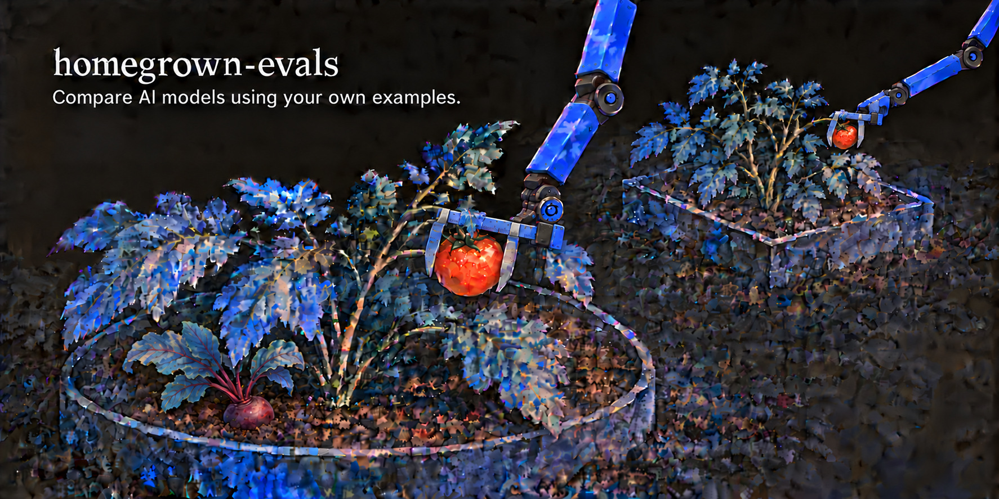

Public benchmarks can't tell you which AI model will do *your* job the way you would. They test general skills against someone else's idea of a good answer. This repo lets you build a benchmark of your own use case, like how you work or what your support chatbot should say, and run models against it before you pick one. It shows where each model fails and what it costs. A second model grades every reply as a judge (LLM-as-a-judge), and you can check that it grades the way you would. The template is built on [Inspect AI](https://inspect.aisi.org.uk/) and opinionated on purpose, so you don't write any code. It fits tasks where the model is given a message or a request and writes one reply, like emails, chatbot answers or summaries, graded against your rules and your voice. For agents that use tools, take several turns or run their own code, use Inspect directly.

The tested model and the judge can be any model Inspect supports. OpenAI, Anthropic, OpenRouter, Together and local models through [Ollama](https://ollama.com/) work as installed. For other providers, add their package first, like `uv add google-genai` for Gemini.

## Example benchmark

The repo comes with **Davidness**, a finished benchmark built loosely around how I work. A model plays an assistant answering my email and Slack the way I would, in 14 cases. It has to notice when IT's email has been hacked, keep a password out of Slack, and fire the slop cannon at AI-written sales pitches. For the record, I'd never let a model answer my messages as me, probably 🤖. It just made an easy example, since I'm an expert at being me.

You can run it, read it and copy from it, in [`examples/davidness/`](examples/davidness/). [Its README](examples/davidness/README.md) covers what each case tests, how the judge was checked, what the models did, and the decisions behind it.

## Quick start

Create your own copy with **Use this template** and choose Private, since your brief will describe who's who and how you work. Clone it, then set it up. You need [uv](https://docs.astral.sh/uv/getting-started/installation/), which installs the right Python for you, plus an API key for each provider you use (or Ollama for free local models).

```bash
uv sync                      # Python 3.11+ and every package, at the exact versions in uv.lock
source .venv/bin/activate    # or start each command below with uv run
cp .env.example .env         # pick the model to test and the judge, and add your API keys
```

To see what you'll get, open Davidness's results. They're built from the runs in the repo, so it's free:

```bash
python -m leaderboard --benchmark examples/davidness examples/davidness/logs --viewer
python3 -m http.server 8765 --bind 127.0.0.1 --directory site/davidness    # then open http://127.0.0.1:8765
```

### Build your own

You don't write any code. You fill in the plain-text files in the repo root, which have instructions in comments, and run a few commands.

**Write the cases yourself.** They are the benchmark. Each one is what the model is given, like a message or a request, the reply you'd want back, and what a good reply must do. If a model writes them, the benchmark tests what a model thinks a good reply is, and every score after that is meaningless. An AI can help with the rest, but not with this.

1. **Describe the role:** fill in `brief.md` with who the model plays and how it decides, and `style.md` with how it writes.
2. **Write your cases** in `cases.yaml`, each with an `id` (see [Case fields](docs/writing-a-benchmark.md#case-fields)).
3. **Optional, add deterministic checks** to `checks.py`, for hard rules code can verify, like a length limit. A coding agent can write them. Have it test each one, and run `ruff check --fix` and `ruff format`.
4. **Check your files:** run `pytest`. It's free.
5. **Test the judges:** in `judge_tests.yaml`, add a few replies that get something wrong, with the grades they should get (its comments show the format). Then run `python -m calibration test-judges` (see [Testing the judges](docs/checking-the-judge.md#testing-the-judges)).
6. **Try one case:** run `inspect eval task.py --limit 1 --log-dir logs/smoke`, then read the reply and the judges' reasoning with `inspect view --log-dir logs/smoke`.
7. **Run your models:** add their prices to `prices.yaml`, following its comments (leave out local models, which are free), and run `pytest` to check them. Then run `inspect eval task.py --model <model-a>,<model-b> --epochs 3`. The judge comes from `.env`. To try a model at another reasoning effort, run it again with `--reasoning-effort high`, and it gets its own row.
8. **See the results:** run `python -m leaderboard`, or add `--viewer` for a web page with every reply, then open it with the command it prints.

Prefer to be guided? Paste this into a coding agent, like Claude Code or Cursor, opened in this repo:

```
Help me build my own benchmark with this repo, following the Quick start in its README. Guide me one step at a time.

- Interview me to fill in brief.md and style.md, and show me each file before saving it.
- Don't write my cases or golden answers. For each case, ask me what the model is given, the reply I'd want, what a good reply must do and a short id, then put my words into cases.yaml.
- Only add a check to checks.py for a hard rule I name, and test it on sentences that should pass and sentences that should fail.
- Run pytest after every change. Fix what you wrote, but if one of my cases or golden answers fails, show me and let me fix it.
- For judge_tests.yaml, you can draft replies that get something wrong, but I decide the grades each one should get.
- Don't guess model prices for prices.yaml. Take them from each provider's pricing page, and show me where they came from.
- Ask before running anything that calls a model, and tell me roughly what it will cost.
```

Before you trust the scores, [check that the judge grades the way you would](docs/checking-the-judge.md#comparing-the-judge-with-your-grades).

## Going deeper

- [Writing a benchmark](docs/writing-a-benchmark.md): how the pieces fit, every case field, and writing your own grades.
- [Checking the judge](docs/checking-the-judge.md): testing the judges, comparing them with your own grades, and panels of judges.
- [Comparing models](docs/comparing-models.md): reading the leaderboard, costs, the benchmark version, publishing the results, and running Davidness yourself.
